# Implementation Plan: Offline NVIDIA GPU Unrestricted Multi-Agent System (CyberAgent X)

Build an end-to-end, 100% offline-capable, NVIDIA GPU-accelerated multi-agent AI system with unrestricted search, deep cybersecurity analysis, threat intelligence, code generation, and multi-agent coordination powered by local Ollama models on RTX 3050 (6GB VRAM).

---

## System Architecture Overview

```mermaid
flowchart TD
    subgraph UI ["User Interfaces"]
        WEB["🌐 Modern Cyber Studio (React + Vite Web UI)"]
        CLI["💻 Interactive Terminal CLI (Rich + Fallback Prompt)"]
    end

    subgraph BACKEND ["FastAPI & WebSocket Core Server"]
        ROUTER["API Router & Event Dispatcher"]
        ORCH["👑 Master Orchestrator (DAG Generator)"]
        BUS["⚡ Async Message Bus & Stream Manager"]
        GPU_MON["📊 Live GPU & VRAM Monitor (NVML / SMI)"]
    end

    subgraph TOOLS ["Unrestricted Tool & Search Engine"]
        WEB_SRCH["🌐 Multi-Source Web Search (DDG / Crawl / Fallbacks)"]
        LOCAL_RAG["📁 Offline Vector & BM25 Document Ingestor"]
        CODE_EXEC["🐍 Local Python Code Sandbox & Shell Tool"]
        PCAP_TOOL["📡 Network & Packet Analysis Tool"]
    end

    subgraph AGENTS ["Specialized Multi-Agent Swarm"]
        A1["👑 Master Orchestrator (qwen3:8b)"]
        A2["🕵️ OSINT & Deep Search (qwen3:4b)"]
        A3["🧠 Threat Intel & CoT (deepseek-r1:8b)"]
        A4["💻 Offensive & Defensive Coder (qwen2.5-coder:7b)"]
        A5["🔬 Malware & Reverse Eng (qwen3:8b)"]
        A6["📡 Network & Protocol Analysis (gemma3:4b)"]
        A7["📝 Executive Report Generator (gemma3:4b)"]
        A8["⚔️ Red Team & CTF Simulator (phi4-mini:3.8b)"]
    end

    subgraph INFERENCE ["Local NVIDIA GPU Engine (RTX 3050 6GB)"]
        OLLAMA["🦙 Ollama Local Inference Engine (CUDA 13.2)"]
        VRAM_MGR["⚖️ Dynamic VRAM Swapper & Model Lifecycle Manager"]
    end

    UI --> BACKEND
    BACKEND --> TOOLS
    BACKEND --> AGENTS
    AGENTS --> INFERENCE
    TOOLS --> AGENTS
```

---

## Hardware & Model Assignment for 6GB VRAM

| # | Agent | Role | Model | VRAM / Context | Reason |
|---|---|---|---|---|---|
| 1 | 👑 **Master Orchestrator** | Task planning & DAG routing | `qwen3:8b` | ~5.0 GB | Superior reasoning & task decomposition |
| 2 | 🕵️ **OSINT & Deep Search** | Multi-source web search & RAG | `qwen3:4b` | ~2.5 GB | Fast, lightweight, unrestricted query parsing |
| 3 | 🧠 **Threat Intelligence** | CoT analysis & vulnerability triage | `deepseek-r1:8b` | ~5.0 GB | Step-by-step deep reasoning (`<think>`) |
| 4 | 💻 **Offensive/Defensive Coder**| Exploit scripts, patches & tools | `qwen2.5-coder:7b`| ~4.5 GB | Premier local coding & scripting model |
| 5 | 🔬 **Malware & Reverse Eng** | Disassembly & shellcode parsing | `qwen3:8b` | ~5.0 GB | High context window & binary understanding |
| 6 | 📡 **Network & Packet Analyst** | PCAP dissection & protocol triage| `gemma3:4b` | ~2.5 GB | High throughput for stream processing |
| 7 | 📝 **Executive Report Generator**| Markdown & PDF report synthesis | `gemma3:4b` | ~2.5 GB | Clean, structured report drafting |
| 8 | ⚔️ **Red Team & CTF Simulator** | Emulation & tactical walkthroughs | `phi4-mini:3.8b` | ~2.3 GB | Ultra-fast CTF problem solving |

---

## Proposed Changes & Components

### 1. Core Engine & VRAM Optimization (`core/`)
- `config.py`: Host settings, model parameters, unrestricted system prompts.
- `model_manager.py`: Dynamic GPU VRAM monitor (`nvidia-smi` / `pynvml`), automated model swapper & memory guard.
- `message_bus.py`: Asynchronous publish-subscribe event bus for inter-agent messages and token streaming.
- `pipeline.py`: Directed Acyclic Graph (DAG) executor supporting multi-stage swarm coordination.

### 2. Unrestricted Search, RAG & Tool Engine (`tools/`)
- `search_engine.py`: Limitless multi-engine search (DuckDuckGo, Wikipedia, ArXiv, direct crawler, offline knowledge base).
- `document_rag.py`: Local document indexing (PDF, PCAP, code, logs, text) with BM25 / vector similarity.
- `code_sandbox.py`: Offline Python script & shell execution sandbox.

### 3. Specialized Multi-Agent Swarm (`agents/`)
- `base_agent.py`: Base agent class with streaming, `<think>` reasoning tag handling, and tool execution.
- `orchestrator_agent.py`, `osint_agent.py`, `threat_intel_agent.py`, `coding_agent.py`, `malware_agent.py`, `network_agent.py`, `report_agent.py`, `redteam_agent.py`.

### 4. Backend API & Real-time WebSockets (`api/`)
- `server.py`: FastAPI server with live WebSocket streaming, REST endpoints for search, RAG upload, code sandbox, and pipeline execution.

### 5. Cyber Studio Web UI (`web/`)
- Vite + React + Dark Glassmorphism Cyberpunk theme.
- Interactive multi-agent DAG visualizer, live GPU VRAM HUD, split `<think>` reasoning view, file drop zone, and terminal console.

### 6. Interactive Terminal CLI & Quick Launchers
- `main.py`: Interactive and headless CLI launcher.
- `start.bat`: One-click system verification and launcher.

---

## Verification Plan
1. Run `python main.py --check` to verify NVIDIA GPU, CUDA, Ollama, and local models.
2. Run test searches and local document ingestion.
3. Execute end-to-end multi-agent pipeline query.
4. Launch FastAPI server + Cyber Studio Web UI and test live streaming.
