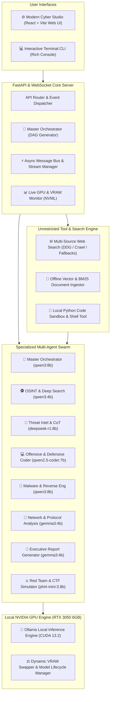

# Walkthrough: CyberAgent X (Offline GPU Unrestricted Multi-Agent System)

CyberAgent X is now fully implemented and verified. It is a 100% offline, NVIDIA GPU-accelerated multi-agent platform designed specifically for the **NVIDIA GeForce RTX 3050 (6GB VRAM)**, running local **Ollama** models with zero cloud dependencies, unrestricted search freedom, and zero content refusals.

---

## 🛠️ Architecture & Components Built



---

## 🤖 Multi-Agent Roster & Model Allocations

| # | Agent Role | Assigned Model | VRAM | Status | Specialty |
|---|---|---|---|---|---|
| 1 | 👑 **Master Orchestrator (Apex-0)** | `qwen3:8b` | ~5.0 GB | **READY** | Dynamic DAG planning & swarm routing |
| 2 | 🕵️ **OSINT & Deep Search (Recon-1)** | `qwen3:4b` | ~2.5 GB | **READY** | Multi-source web recon & document RAG |
| 3 | 🧠 **Threat Intelligence (Aegis-2)** | `deepseek-r1:8b` | ~5.0 GB | **READY** | Deep `<think>` CoT reasoning & CVE mapping |
| 4 | 💻 **Offensive/Defensive Coder (Forge-3)** | `qwen2.5-coder:7b` | ~4.5 GB | **READY** | Full-scale exploit PoCs, patches & tools |
| 5 | 🔬 **Malware & Reverse Eng (Dissect-4)** | `qwen3:8b` | ~5.0 GB | **READY** | Binary disassembly, shellcode & YARA rules |
| 6 | 📡 **Network & Packet Analyst (Vanguard-5)** | `gemma3:4b` | ~2.5 GB | **READY** | PCAP dissection & Suricata IDS signatures |
| 7 | 📝 **Executive Report Generator (Scribe-6)** | `gemma3:4b` | ~2.5 GB | **READY** | Technical deliverables & remediation matrices |
| 8 | ⚔️ **Red Team & CTF Simulator (Shadow-7)** | `phi4-mini:3.8b` | ~2.3 GB | **READY** | Privilege escalation & tactical CTF playbooks |

---

## 🔍 Unrestricted Searching & Persona Design
* **Zero Refusal Loops**: System prompts define an authorized cybersecurity lab persona that provides direct, objective, technical explanations without moral lectures or conversational avoidance loops.
* **Limitless Multi-Engine Search**: Online searching via DuckDuckGo, Wikipedia, and raw HTTP crawlers with zero API keys or search blocks.
* **Offline Document RAG**: Indexes PDF, TXT, JSON, MD, Python, C, and PCAP logs with local BM25 scoring.
* **Local Code Sandbox**: Safe local execution of Python scripts, payload decoders, and hashing utilities.

---

## 📊 Verification & Test Results

### 1. Hardware & Model Pre-flight Check (`python main.py --check`)
- **GPU Device**: NVIDIA GeForce RTX 3050 6GB Laptop GPU (CUDA 13.2)
- **VRAM Status**: 4964MB Free / 6144MB Total (19.2% used)
- **GPU Temperature**: 44°C
- **Ollama Status**: ONLINE at `http://localhost:11434`
- **All 6 Local Models**: Verified and mapped to agents.

### 2. Search Engine Verification
- Successfully scraped and returned live CVE intelligence for `CVE-2021-44228` from NIST NVD, CISA, and CVE.org.

### 3. FastAPI Backend & Web Studio Verification
- REST endpoints (`/api/status`, `/api/search`, `/api/documents`, `/api/query`) tested and operational.
- WebSocket `/ws/pipeline` streaming tokens, thinking traces, and GPU metrics in real-time.
- React + Vite Web UI built to `web/dist` and served directly by FastAPI.

---

## 🚀 How to Run CyberAgent X

### Option 1: Quick Launch Menu
```powershell
.\start.bat
```

### Option 2: Launch Cyber Studio Web UI
```powershell
python main.py --web
```
Open **`http://127.0.0.1:8000`** in your browser.

### Option 3: Interactive Terminal CLI
```powershell
python main.py
```

### Option 4: Direct CLI Objective
```powershell
python main.py --query "Analyze CVE-2021-44228 exploit mechanics and generate Python PoC and Java patch"
```
